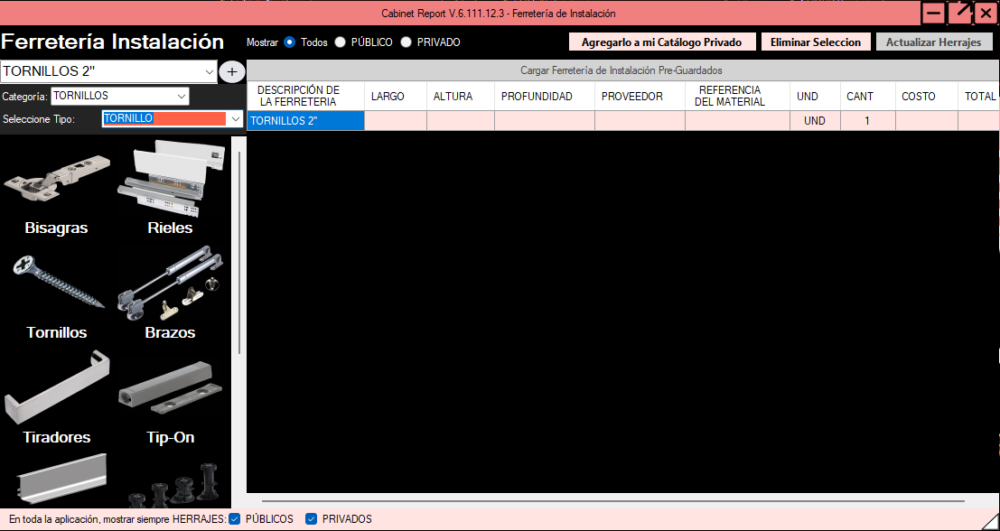

# Costos

El módulo **Costos** permite organizar la materia prima, los importes y las condiciones comerciales de un proyecto por ambientes, para preparar **cuadros de costos y cotizaciones**. Esta lección parte de los controles y capturas históricos del Curso y los relaciona con el [Reporte de Compras](reporte-de-compras.md) y la [documentación oficial de Costos](https://cabinet-report.gitbook.io/cabinet-report-docs/funcionalidades-de-cabinet-report/costos-en-desarrollo).

<figure><figcaption>
Vista general de Costos: comprueba el proyecto y el ambiente antes de valorar materiales.
</figcaption></figure>


**Alcance de la lección:** Costos es una funcionalidad existente, no una función en desarrollo. Los nombres y controles ilustrados pueden variar según la versión instalada y los permisos. Las reglas históricas sobre archivos y ambientes son referencias para verificar en el programa; no constituyen pruebas funcionales de la versión actual.


## Ruta de aprendizaje

**Del RP a la cotización:** comienza con el [Reporte de Producción revisado](reporte-de-produccion/README.md), continúa con el [Reporte de Compras](reporte-de-compras.md) y concilia aquí las partidas de cada ambiente antes de exportar. Si detectas una discrepancia de funcionamiento, consulta [Reporte de Errores o Feedback](reporte-de-errores-o-feedback.md).

Esta lección incluye un **ensayo de trazabilidad** para practicar el control sin cambiar datos comerciales reales. Las capturas son referencias de la interfaz; comprueba qué opciones ofrece tu instalación.

**Responsabilidad de cada documento:** no trates la lista de insumos, la valoración y una operación comercial como un mismo resultado.

| Etapa | Qué permite comprobar | Qué no acredita por sí sola |
| --- | --- | --- |
| **Reporte de Producción (RP)** | Piezas, materiales y datos técnicos del ambiente revisado. | Necesidad comercial expresada en unidades de compra o costo vigente del proveedor. |
| **Reporte de Compras (RC)** | Materiales y cantidades consolidados para preparar abastecimiento, con su trazabilidad cuando está disponible. | Pedido emitido, existencia en almacén, recepción o pago. |
| **Costos y cotización** | Partidas valoradas, condiciones, resultados por ambiente y archivo de oferta revisable. | Aceptación del cliente, facturación, compra realizada ni ejecución de fabricación. |

Si cambia el RP o el Excel de Compras, reconcilia de nuevo las cantidades antes de reutilizar un presupuesto. El flujo descrito es una guía de trabajo, **no una sincronización automática acreditada**.

## Antes de comenzar

1. Prepara el [Reporte de Producción](reporte-de-produccion/README.md) y el [Reporte de Compras](reporte-de-compras.md) que correspondan al trabajo. Confirma **cliente, proyecto, ambiente, materiales, cantidades y unidades**.
2. Ubica el **Excel XLSX de compras** o, si continúas un presupuesto anterior, su **XML de Costos**. Conserva una copia del archivo original antes de cargar o reemplazar datos.
3. Reúne precios comprobables del proveedor, unidades de compra y condiciones comerciales. No consideres vigente un precio solo porque figure en el catálogo.
4. Define qué ambientes incluirá el presupuesto y cuáles partidas son compartidas, para evitar omisiones o dobles conteos.

**Distingue tres conceptos:** el *cliente activo* identifica la instalación y sirve de referencia para los catálogos privados; el *proyecto* identifica el trabajo que se está cotizando; y cada *ambiente* agrupa las partidas que corresponden a un espacio del proyecto. La [especificación técnica histórica](https://github.com/danielmelendez-pma/DocumetacionTecnicaCabinetReport/blob/main/modulo-costos.md) indica que un nombre de cliente leído de Excel, XML o PDF no debe sustituir al cliente activo. Comprueba esta separación al importar.

## 1. Conocer el menú Opciones

<figure><figcaption>
Desde Opciones se seleccionan los archivos de entrada y se revisan las configuraciones disponibles.
</figcaption></figure>

El menú documentado reúne estas acciones:

| Opción | Para qué se utiliza | Qué debes verificar |
| --- | --- | --- |
| **Cargar reportes de compra XLSX** | Incorporar materiales desde los Excel generados en Reporte de Compras. | Proyecto, ambiente, descripciones, cantidades y unidades del archivo elegido. |
| **Cargar archivos de Costos XML** | Recuperar un presupuesto previamente trabajado en Costos. | Que corresponda al proyecto esperado y que no sustituya datos de otro ambiente. |
| **Agregar archivo Promob PDF** | Procesar un PDF de materiales procedente de Promob, cuando su formato sea compatible. | Importación real de partidas; no se garantiza compatibilidad con todos los PDF. |
| **Cargar Precios Unitarios** | Buscar coincidencias de materia prima en los catálogos registrados. | Unidad, identificación y costo resultantes, además de las coincidencias no encontradas. |
| **Márgenes** y **Notas Globales** | Guardar o limpiar configuraciones reutilizables. | Diferenciar ajustes del cliente de referencias particulares de cada proyecto. |
| **Limpiar** | Reiniciar el formulario según el recorrido histórico. | Respaldar cualquier trabajo que aún no se haya guardado. |


**Importar no equivale a validar.** Un XLSX, XML o PDF puede contener materiales o importes desactualizados, cantidades duplicadas y referencias de otro proyecto. Contrasta siempre la tabla que aparece después de la carga.


## 2. Cargar y comprobar la materia prima

1. En **Opciones**, elige la carga compatible con el archivo que preparaste.
2. Después de importar, revisa el listado de **Materia Prima**: **DESCRIPCION, UND, ID, TIPO y COST-UNIT**, además de las cantidades e importes que muestre tu versión.
3. Compara las descripciones y unidades con el [Reporte de Compras](reporte-de-compras.md). Si hay tableros, cantos o herrajes con nombres parecidos, no los declares equivalentes sin comprobar la referencia.
4. Comprueba el ambiente al que se asignaron las partidas y evita cargar dos veces la misma fuente.
5. Antes de avanzar, identifica los renglones sin precio, con cantidad inesperada o con unidad incompatible con la compra real.

### Catálogos públicos y privados

<figure><figcaption>
Los filtros Pública y Privada ayudan a distinguir la procedencia de las referencias y sus costos.
</figcaption></figure>

La interfaz histórica incluye filtros **Pública** y **Privada** para las referencias de tableros y herrajes. La documentación del Curso indica que pueden estar ambos activos, pero no los dos desactivados; filtrar las listas de selección no debería reemplazar por sí solo las partidas ya cargadas.

- **Pública:** referencias generales visibles según los permisos y el catálogo.
- **Privada:** referencias asociadas al cliente activo, no a un supuesto cliente leído del archivo importado.
- **Ambas:** revisar de cuál catálogo procede la referencia seleccionada y cuál precio se está utilizando.

Si una referencia no aparece, comprueba permisos, visibilidad, cliente activo y descripción antes de crear o elegir otra. Consulta [Creación de Tableros](creacion-de-tableros.md) y [Creación de Herrajes](creacion-de-herrajes/README.md).

### Buscar precios unitarios

La descripción histórica de **Cargar Precios Unitarios** especifica una búsqueda por coincidencia de texto entre la columna **DESCRIPCION** de Materia Prima y los registros de las tablas de herrajes (`TblAccHerrajes`) y tableros (`TblAglomerados`).

| Origen histórico | Campos consultados | Resultado esperado en la tabla |
| --- | --- | --- |
| **Herrajes**: descripción coincidente | `IdAccesorio`, `Tipo`, `Costo`, `Unidad` | Completar **ID**, **TIPO**, **COST-UNIT** y **UND**. |
| **Tableros**: nombre de aglomerado coincidente | `IdAglomerado`, `PrecioProveedor` | Completar **ID** y **COST-UNIT**; tipo **Tablero** y unidad **UND** según el ejemplo original. |


**Coincidencia no es equivalencia técnica ni precio confirmado.** El texto original describe comparación de descripciones tal como están escritas, sin normalización del texto. Si no hay coincidencia, si existen nombres similares o si el costo parece incorrecto, revisa manualmente la referencia, su unidad, proveedor, moneda, impuestos y vigencia. No inventes un costo para completar la tabla.


### Identificar qué precio se está utilizando

Para cada partida, distingue **procedencia, vigencia y aplicación**; una coincidencia de catálogo es solo una referencia de partida.

| Estado del importe | Evidencia que lo respalda | Decisión de revisión |
| --- | --- | --- |
| **Precio registrado** | Valor visible en catálogo público/privado o archivo importado, con referencia y unidad. | No presentarlo como precio actual del proveedor. |
| **Precio vigente comprobado** | Fuente autorizada, proveedor, fecha, moneda, presentación y condiciones verificadas. | Confirmar que corresponde a la misma especificación y unidad. |
| **Costo unitario aplicado** | Valor que aparece en `COST-UNIT` para la partida y ambiente elegidos. | Compararlo con la evidencia vigente; no asumir que una búsqueda lo actualizó correctamente. |
| **Costo calculado mostrado** | Cantidad, unidad y subtotal observables en la versión utilizada. | Conciliar con una comprobación externa y registrar diferencias; no inferir la fórmula interna. |

**Control de cambios:** si el catálogo muestra un precio, pero aún no se confirma su vigencia, documenta la discrepancia. No sustituyas silenciosamente el precio registrado, no atribuyas al programa una actualización en línea y no uses un valor faltante como si fuera cero.

### Agregar o revisar una partida manualmente

<figure><figcaption>
La tabla de Materia Prima permite cotejar la descripción, la unidad y los costos con la fuente.
</figcaption></figure>

La lección original permite **seleccionar una descripción del listado o escribir una nueva**. Cuando una referencia coincide con el catálogo, la interfaz documentada puede completar **UND, ID, TIPO y COST-UNIT**. Para una partida escrita manualmente, verifica esos campos por separado: el texto ingresado no demuestra que exista un registro ni que tenga precio.

**Para partidas manuales**, registra una referencia que permita reconocer el material, la **cantidad y su unidad**, una presentación compatible con la compra, el origen del precio y el ambiente asignado. Revisa especialmente valores ausentes, importes escritos como texto, referencias duplicadas y cantidades cero o negativas: el documento no acredita que la interfaz los detecte o rechace automáticamente. Un registro escrito a mano tampoco crea por sí solo un material en el catálogo.

Si la descripción coincide pero difieren espesor, formato, acabado, unidad o proveedor, mantén las partidas separadas hasta verificar equivalencia. No agrupes partidas únicamente porque compartan texto o un identificador parcial.

## 3. Administrar márgenes y notas

### Márgenes de producción y operación

<figure><figcaption>
Antes de guardar o limpiar márgenes, comprueba la configuración que corresponde al trabajo.
</figcaption></figure>

El recorrido documentado distingue **margen de producción** y **margen operativo**. La acción **Guardar Márgenes** utiliza los archivos `MargenProduccion.xml` y `MargenOperativo.xml` en la carpeta `ArchivosCliente` de la instalación. La acción **Limpiar Márgenes**, según esa documentación, elimina los archivos almacenados.

**Antes de limpiar:** conserva un respaldo de esos XML si necesitas recuperar la configuración. Después de guardar o cargar, comprueba en pantalla que las condiciones realmente corresponden a la cotización actual.

### Diferenciar margen de recargo y condiciones de comercialización

La documentación oficial acredita **margen de producción (MP)**, **margen operativo (MO)** y una sección de **precio de venta**. No acredita un tercer control autónomo llamado «margen de comercialización». La decisión comercial final incluye revisar la oferta, sus condiciones y su precio; no la confundas con los conceptos de fabricación u operación.

En una comparación **matemática externa**, cuando costo y precio de venta sean válidos y positivos:

- **Recargo respecto del costo:** (precio de venta − costo) ÷ costo.
- **Margen respecto de la venta:** (precio de venta − costo) ÷ precio de venta.

**No son porcentajes intercambiables.** Estas identidades son referencias para revisar una oferta, **no fórmulas atribuidas a Cabinet Report** ni instrucciones para modificar sus márgenes configurados. Antes de aplicar un porcentaje, confirma su base, concepto, unidad monetaria y quién lo autorizó. No se prescribe ninguna tasa.

### Notas globales y notas del proyecto

<figure><figcaption>
Las Notas Globales reúnen condiciones reutilizables; la referencia debe corresponder al proyecto actual.
</figcaption></figure>

Las **Notas Globales** recogen condiciones reutilizables del cliente, como forma de pago, suministro, instalación, exclusiones y observaciones. La acción **Guardar Notas Globales** utiliza `ArchivosCliente/NotasGlobales.xml`; **Limpiar Notas Globales** se describe históricamente como eliminación de ese archivo.

La **referencia del proyecto**, en cambio, pertenece al presupuesto de ese proyecto. La especificación técnica histórica la sitúa en su propio XML y no en `NotasGlobales.xml`. Evita arrastrar la referencia de un cliente o proyecto anterior al cotizar un trabajo nuevo.


**Diferencia entre limpiar acciones:** **Limpiar** el formulario, **Limpiar Márgenes** y **Limpiar Notas Globales** se describen como operaciones distintas. Antes de ejecutar una de ellas, verifica el alcance en tu versión y conserva copia de los archivos que deseas recuperar.


## 4. Organizar los ambientes

La [especificación técnica del módulo Costos](https://github.com/danielmelendez-pma/DocumetacionTecnicaCabinetReport/blob/main/modulo-costos.md) describe cada ambiente como una unidad con lista de materiales, cantidades y costos propios. No se debe dar por hecho que ese comportamiento histórico haya sido validado en todas las versiones.

Para una cotización con varios ambientes:

1. Identifica cada ambiente del proyecto y comprueba que su listado contiene únicamente las partidas correspondientes.
2. Al cambiar de ambiente, revisa qué partidas se muestran; no presupongas que un elemento visible en un ambiente pertenece a todos.
3. Si importas varios archivos, comprueba que no se repitan materiales ni se sobrescriban las referencias o cantidades de otro ambiente.
4. Revisa por separado el resumen global del proyecto y los subtotales por ambiente antes de presentar una cifra consolidada.

**Control adicional de aislamiento:** cuando se carguen dos archivos de un mismo proyecto, anota el listado de A, luego de B y de nuevo de A. Las reglas de independencia descritas en `modulo-costos.md` son **expectativas normativas históricas**, no pruebas de que la versión instalada retenga las ediciones al cambiar de ambiente o al cerrar la ventana. Comprueba por separado el **cliente activo** antes y después de importar: ningún dato de un XML, XLSX o PDF debe ser tratado como autorización para consultar el catálogo privado de otro cliente.

## 5. Comprobar importes y preparar la cotización

La [documentación oficial de Costos](https://cabinet-report.gitbook.io/cabinet-report-docs/funcionalidades-de-cabinet-report/costos-en-desarrollo) describe materia prima, márgenes de producción y operación, precio de venta, ITBMS, resumen de ambientes, notas y condiciones.

1. Revisa **cantidad, unidad y costo unitario** de cada partida; un valor en una unidad distinta puede alterar todo el presupuesto.
2. Contrasta los importes de **materia prima**, **márgenes** y **precio de venta**, sin tratar sus conceptos como intercambiables.
3. Comprueba el **ITBMS** aplicable y las condiciones reales de la operación; no presupongas una tasa universal.
4. Verifica que las notas, exclusiones, forma de pago y referencia correspondan al proyecto actual.
5. Comprueba si las partidas comunes se han incluido una sola vez y si existen materiales o herrajes sin costear.

### Separar cálculo, ajustes y cotización final

La cantidad homogénea y el costo unitario comprobado permiten una **comprobación manual de referencia**; el costo mostrado por la aplicación debe revisarse contra sus partidas, sin deducir a partir del nombre del campo qué fórmula interna se utilizó.

La fuente oficial documenta **ITBMS**, pero no establece en esta página un procedimiento verificable para **descuentos, orden de aplicación o redondeos**. Por ello, no se presume que el programa aplique un descuento específico ni un redondeo concreto. Si tu versión presenta dichos campos o diferencias de centavos, registra la base, importes intermedios, visualización y archivo exportado para revisión comercial y funcional.

Distingue los tres estados al revisar el proyecto: **costo estimado** (según datos cargados y todavía contrastables), **precio de venta mostrado** (resultado de la configuración revisada) y **cotización final preparada** (archivo exportado, comprobado y aprobado internamente para su uso). Ninguno acredita por sí mismo una venta aceptada.

### Guardar y exportar

La documentación oficial indica que Costos contempla **Exportar costos** y salidas a **Excel (.xlsx)**, además de cotización en **Word (.docx) tipo carta** o **Excel (.xlsx) tipo tabla**. Para esas dos presentaciones de cotización, se requiere primero disponer de un **Excel de costos exportado**.

Después de exportar, abre el documento generado y contrasta proyecto, ambientes, partidas, márgenes, impuestos y total con la vista revisada en Costos. Conserva el XML de Costos y el Excel fuente cuando corresponda para facilitar la recuperación.


**El archivo exportado no certifica que el presupuesto sea correcto ni que haya sido aceptado.** Valida la cotización con los precios actuales y las condiciones comerciales antes de entregarla al cliente. Tampoco confundas esta cotización con la estimación económica de hallazgos del Revisor IA, que tiene otra finalidad.


**Guardar no es sinónimo de exportar:** identifica la acción de guardado realmente utilizada, la ruta del XML de Costos del **proyecto**, la existencia del XLSX exportado y, cuando corresponda, la cotización Word/Excel creada **a partir de ese Excel**. Las notas y márgenes globales documentados en `ArchivosCliente` son archivos diferentes del XML del proyecto. No supongas que cualquier edición se persiste automáticamente ni que al volver a abrir se recuperan todos los valores: compruébalo con un archivo de prueba y un cierre/reapertura controlados.

Para cada salida, registra **nombre, carpeta, fecha, extensión y versión**, comprueba que se pueda abrir y coteja al menos una partida de cada ambiente con su origen. No sobrescribas la única copia de una cotización aprobada.

## 6. Si algo no coincide

| Situación | Comprobación recomendada |
| --- | --- |
| **No se cargó una partida** | Verifica formato de origen, contenido del archivo y ambiente seleccionado. |
| **No aparece un precio unitario** | Comprueba descripción, catálogo público/privado, cliente activo y vigencia del precio; registra el faltante sin inventar el importe. |
| **El total cambió al importar otro ambiente** | Revisa duplicados, unidades y asignación de materiales por ambiente. |
| **Aparecen notas o márgenes anteriores** | Identifica los archivos globales de `ArchivosCliente` y diferencia sus datos de los propios del proyecto. |
| **No se genera la cotización** | Comprueba que exista el Excel de Costos exportado requerido y revisa los mensajes de la aplicación. |

## 7. Ensayo reproducible: de Compras a cotización

Este ejercicio conecta la [conciliación del Reporte de Compras](reporte-de-compras.md) con la valoración en **Costos**. Es una **prueba documental y manual**, no una función nueva de Cabinet Report ni un resultado verificado en Windows. Usa archivos compatibles con tu versión y un proyecto de prueba que puedas descartar.


**Protege los presupuestos reales:** conserva copias de los RP, Excel de Compras, XML de Costos y archivos de configuración global. No cambies precios, márgenes ni datos de producción vigentes para completar este ejercicio.


### A. Preparar dos ambientes con fuentes identificables

Parte de dos RP previamente revisados del mismo proyecto de práctica, por ejemplo **COCINA-ENSAYO** y **CLÓSET-ENSAYO**, y sus Excel de Compras. Los siguientes números son **datos didácticos ficticios**: no representan una salida del software, un despiece estándar ni cantidades reales.

| Partida con una misma especificación | Unidad | Cocina | Clóset | Total esperado |
| --- | --- | ---: | ---: | ---: |
| Tablero de melamina, mismo espesor y formato | hojas | 3 | 2 | **5** |
| Canto, misma referencia y ancho | metros | 20 | 20 | **40** |
| Bisagra, mismo modelo y referencia | unidades | 8 | 16 | **24** |

1. Anota el **cliente activo de la instalación**, el **nombre del proyecto**, el **ambiente**, el número o referencia del RP y la versión de cada archivo. El cliente activo no debe confundirse con el nombre del proyecto importado.
2. Para cada partida, registra su **descripción técnica, unidad y cantidad** según el RP y el Excel de Compras correspondiente. No asignes un total consolidado a un ambiente por suposición.
3. Si una fuente usa cajas y la otra unidades individuales, consigue la equivalencia de presentación documentada por el proveedor antes de sumar. **Hojas, metros y unidades no se suman entre sí.**

### B. Cargar y revisar el aislamiento de los ambientes

1. En una instalación de prueba autorizada, utiliza la opción documentada **Cargar reportes de compra XLSX** con archivos compatibles. Comprueba la identificación y las partidas que efectivamente se importaron; no presupongas que la aplicación detecta duplicados.
2. Selecciona **COCINA-ENSAYO**, registra sus partidas visibles y repite en **CLÓSET-ENSAYO**. Vuelve a Cocina y contrasta cada ambiente con su origen. Si tu versión no dispone de este recorrido, consigna el paso como **NO EJECUTADO**.
3. Comprueba **DESCRIPCION, UND, ID, TIPO, COST-UNIT**, cantidades y cualquier importe mostrado. Revisa también la **procedencia pública o privada** de las referencias seleccionadas.
4. Distingue **Notas Globales**, márgenes reutilizables y **referencia propia del proyecto**. La presencia de configuraciones históricas no demuestra que sean apropiadas para esta cotización.

**Registro A → B → A:** en una hoja de prueba independiente, anota la cantidad esperada y la cantidad observada por partida y ambiente antes y después de alternar la selección. Señala **NO CONFORME** si aparece una partida exclusiva de B en A, si una partida se duplica o si el cliente activo visible cambia por los datos importados. Si faltan controles o no se ejecuta el paso, utiliza **NO EJECUTADO**: no infieras un resultado favorable.

Incluye una partida compartida con igual especificación en ambos ambientes y otra **diferente solo en espesor o presentación**, para comprobar que la consolidación respeta la identidad técnica y la unidad. Este ensayo no prueba el aislamiento del servidor entre clientes; esa comprobación requiere permisos, datos de prueba autorizados y validación funcional independiente.

### C. Encontrar errores antes de valorar

Reproduce las siguientes discrepancias **solo en una hoja de control externa**; no alteres los archivos de producción.

| Error didáctico | Cálculo que revela la discrepancia | Qué hacer |
| --- | --- | --- |
| Contar dos veces el tablero de Cocina | **3 + 3 + 2 = 8 hojas**, frente a las **5** de origen | Identificar y excluir la fuente duplicada; volver a cotejar el resultado. |
| Interpretar las 16 bisagras de Clóset como 16 cajas de 10 | **160 unidades** supuestas en vez de **16 unidades** verificadas | Comprobar la unidad de la fuente; «caja de 10» es solo una hipótesis del ejercicio. |
| Confundir dos referencias de canto por tener nombres similares | Un total de **40 metros** no demuestra que el ancho y el acabado coincidan | Separar por referencia técnica antes de sumar y valorar. |

**Criterio:** el total correcto del ejemplo contiene **5 hojas**, **40 metros** y **24 bisagras**, en partidas diferentes y con las especificaciones indicadas. El conteo de filas de un archivo no sustituye las cantidades efectivas; una coincidencia de nombres tampoco acredita equivalencia técnica.

### D. Verificar la valoración, sin inventar precios

Por cada partida, conserva una evidencia externa con estos datos:

| Campo de control | Evidencia mínima |
| --- | --- |
| Origen | Cliente activo, proyecto, ambiente, RP y Excel de Compras utilizados |
| Material | Descripción, referencia, especificación, cantidad y unidad |
| Precio | Proveedor, presentación, moneda, costo unitario, fecha de verificación y unidad de cotización |
| Condiciones | Márgenes aplicables, tratamiento de ITBMS, notas, exclusiones y responsable |
| Entregable | XML de Costos cuando corresponda, Excel de Costos y cotización exportada, con identificación de versión |

Para revisar manualmente una partida, compara **cantidad homogénea × costo unitario verificado para esa misma unidad**. Esta comprobación **no describe ni modifica la fórmula interna** de Costos. Si falta un costo unitario confiable, marca la partida **PENDIENTE DE VALORACIÓN** y **no la reemplaces por cero** ni presentes el total como cotización definitiva.

No se fija aquí ningún precio, margen, tasa de ITBMS o fórmula comercial: comprueba los valores y condiciones **aplicables a la operación real**. El impacto económico mostrado por el Revisor IA pertenece a otro proceso y no sustituye la cotización comercial.

**Casos de contraste adicionales (en control externo):** identifica una partida sin precio verificado, una descripción coincidente con unidad incompatible y una fuente de Compras repetida. Marca cada una como **PENDIENTE**, **DIFERENCIA** o **RESUELTA CON EVIDENCIA**, según corresponda. No corrijas el importe global por compensación sin encontrar la partida de origen. Cuando haya una diferencia entre subtotal mostrado y comprobación manual, conserva ambos valores y el criterio de redondeo observado, sin atribuir al programa una regla aún no verificada.

### E. Exportar, conciliar y documentar el resultado

1. Con los datos ya revisados, utiliza solo las salidas disponibles en tu versión. Para crear una cotización Word o Excel, la documentación oficial indica que antes debe existir un **Excel de Costos exportado**.
2. Abre el Excel de Costos y la cotización, si existe, y coteja **proyecto, ambientes, partidas, cantidades, unidades, costos, márgenes, impuestos y notas** contra las fuentes y el control manual. Exportar un archivo no significa que haya sido aprobado.
3. Para cada prueba, registra **CONFORME** si se comprobó, **NO CONFORME** si persisten diferencias o **NO EJECUTADO** si faltó la opción, evidencia o ejecución. El trabajo no debe autorizarse para entregar una oferta si quedan partidas duplicadas, unidades incompatibles o precios sin verificar.
4. Si observas un comportamiento del programa que no logras explicar, reúne evidencias sin información sensible y usa la lección [Reporte de Errores o Feedback](reporte-de-errores-o-feedback.md). Los desacuerdos comerciales se resuelven con el responsable del presupuesto y los proveedores.

**Resultado comprobable:** otra persona puede seguir una partida desde el RP al Excel de Compras, identificarla en el ambiente correcto de Costos y localizar el archivo exportado, sin confundir comprobación manual con una función automática.

### Evidencia y criterio de cierre de la prueba

Para cada comprobación conserva **origen → resultado esperado → resultado observado → estado → acción → archivo de evidencia**; identifica versión de Windows, ambiente y fecha, sin incluir costos confidenciales ni datos personales innecesarios.

- **CONFORME:** coincidencia efectivamente observada entre la fuente, el ambiente y la salida evaluada.
- **NO CONFORME:** diferencia reproducible sin resolver; conserva captura, mensaje de error o extracto anonimizado y detén la entrega si afecta el presupuesto.
- **NO EJECUTADO:** no se dispone de versión, archivo compatible, permiso o prueba real. No equivale a aprobación.

Este protocolo **no acredita pruebas Windows realizadas**, cálculos comerciales validados ni permisos de acceso entre clientes. Separa la resolución técnica documentada de la **autorización comercial** y de las actividades de compras o contratación, que ocurren fuera de esta comprobación.

## 8. Lista de comprobación antes de entregar

- [ ] Cliente activo, proyecto y ambientes identificados sin confusión.
- [ ] Archivos importados correspondientes al trabajo y respaldados.
- [ ] Materiales, herrajes, cantidades y unidades cotejados con el Reporte de Compras.
- [ ] Precios unitarios comprobados y faltantes resueltos o expresamente señalados.
- [ ] Márgenes, ITBMS, notas y exclusiones revisados.
- [ ] Ambientes y partidas compartidas revisados para evitar duplicaciones.
- [ ] Excel de Costos y cotización final abiertos y comprobados antes de compartir.

- [ ] Procedencia y vigencia de precios distinguidas del importe aplicado y del costo mostrado.
- [ ] Márgenes de producción y operación diferenciados del recargo y de la decisión comercial.
- [ ] Archivos del proyecto y configuraciones globales identificados; guardado y reapertura comprobados cuando se ejecutaron.
- [ ] Resultado del ensayo A → B → A y de la exportación registrado como CONFORME, NO CONFORME o NO EJECUTADO.

**Consulta relacionada:** [Reporte de Compras](reporte-de-compras.md) · [Tableros](creacion-de-tableros.md) · [Herrajes](creacion-de-herrajes/README.md) · [Documentación oficial — Costos](https://cabinet-report.gitbook.io/cabinet-report-docs/funcionalidades-de-cabinet-report/costos-en-desarrollo) · [Especificación técnica histórica](https://github.com/danielmelendez-pma/DocumetacionTecnicaCabinetReport/blob/main/modulo-costos.md)

---

[← Optimizadores](optimizadores.md) · [Reporte de Errores o Feedback →](reporte-de-errores-o-feedback.md) · [Portada del Curso](README.md) · [🏠 Portal principal](https://danielmelendez-pma.github.io/cabinet-report-partners/)
