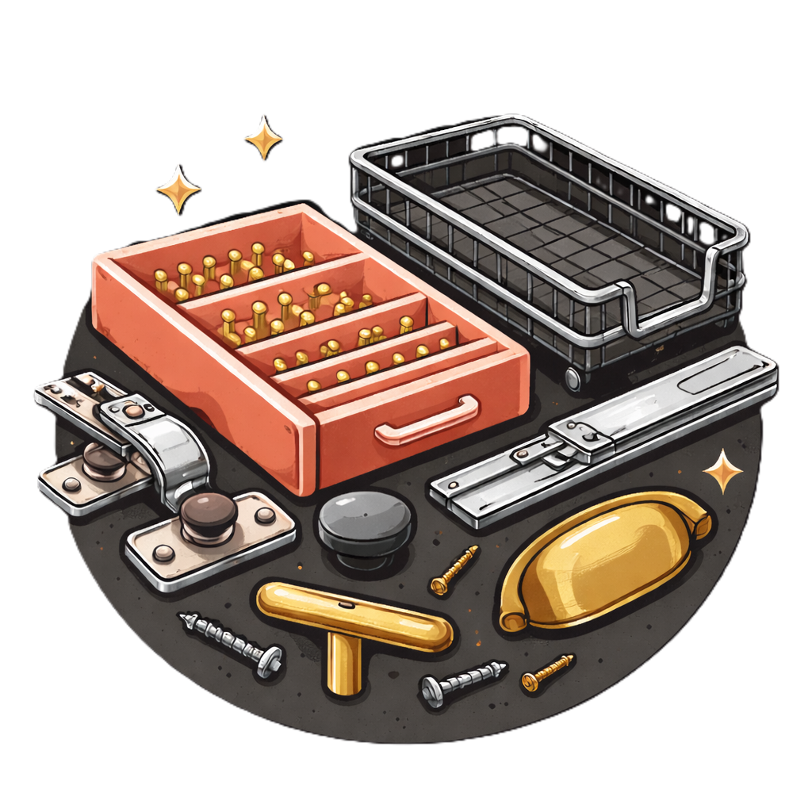
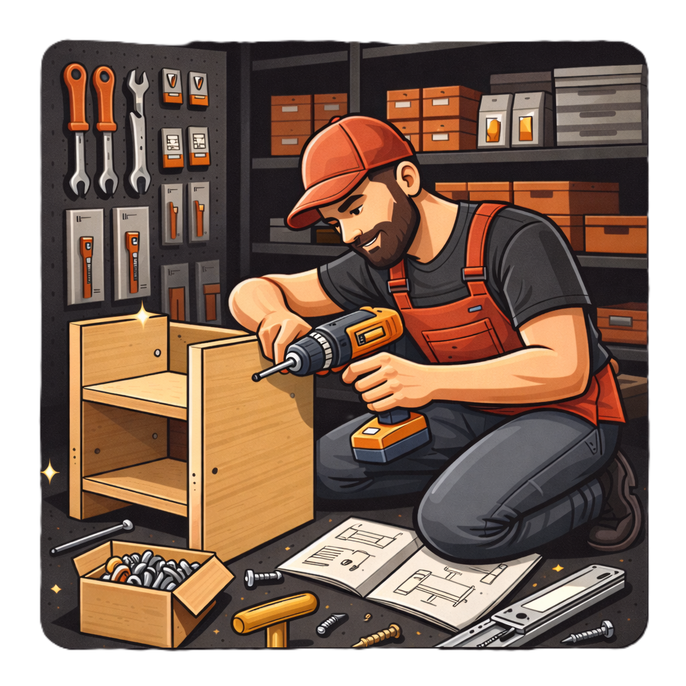

# Creación de Herrajes

**Etapa del curso · Materiales complementarios y fabricación**

El módulo de **Herrajes** organiza los elementos utilizados en los muebles en tres secciones: **Accesorios**, **Ferretería de Montaje** y **Ferretería de Instalación**. Cada sección tiene una lección propia con los controles y capturas de la interfaz.

<figure><figcaption>Vista original de las secciones de herrajes. Las opciones visibles pueden variar según la versión y el usuario.</figcaption></figure>

## 1. Elige la categoría según su función

| Categoría | Para qué se utiliza | Lección paso a paso |
| --- | --- | --- |
| **Accesorios** | Elementos especiales que aportan funcionalidad al mueble. | [Crear y administrar accesorios](accesorios.md) |
| **Ferretería de Montaje** | Herrajes utilizados durante el armado del mueble en fábrica. | [Preparar ferretería de montaje](ferreteria-de-montaje.md) |
| **Ferretería de Instalación** | Herrajes necesarios para instalar el mueble en obra. | [Preparar ferretería de instalación](ferreteria-de-instalacion.md) |

### Accesorios

<figure><figcaption>Accesorios: consulta su registro y sus propiedades en la lección correspondiente.</figcaption></figure>

[Consultar Accesorios →](accesorios.md)

### Ferretería de Montaje

<figure><figcaption>Montaje: herrajes asociados al armado de los muebles en fábrica.</figcaption></figure>

[Consultar Ferretería de Montaje →](ferreteria-de-montaje.md)

### Ferretería de Instalación

<figure><figcaption>Instalación: captura original de su propia lección, en lugar de repetir la imagen de Ferretería de Montaje.</figcaption></figure>

[Consultar Ferretería de Instalación →](ferreteria-de-instalacion.md)

## 2. Distingue dónde se registra y dónde se utiliza

La **existencia de una referencia en el catálogo** no significa que ya esté incorporada al módulo, a una producción ni a sus archivos de salida. Comprueba el contexto en el que trabajas.

| Área de Cabinet Report | Qué puedes revisar o hacer | Qué debes comprobar |
| --- | --- | --- |
| **Menú Herrajes** | Crear y administrar referencias según los controles y permisos disponibles. | Categoría, nombre, tipo, propiedades y visibilidad pública o privada. |
| **Creador de Módulos** | Incorporar los herrajes que correspondan a la definición del mueble. | Asociación con el módulo y cantidad prevista por referencia. |
| **Catálogo de Módulos** | Consultar y, cuando la opción esté disponible, ajustar herrajes de un módulo existente. | Que el cambio corresponda al módulo correcto y quede reflejado en su definición. |
| **Reporte de Producción** | Revisar o agregar los herrajes de la producción en curso, según las opciones de tu versión. | Cliente, ambiente, módulo, referencia, unidad y cantidad realmente incorporadas. |

Para la secuencia de trabajo, consulta [Creación de Módulos](../creacion-de-modulos.md), [Catálogo de Módulos](../catalogo-de-modulos.md) y [Reporte de Producción](../reporte-de-produccion/README.md).

## 3. Comprueba los herrajes antes de fabricar o instalar

1. **Identifica el herraje.** Compara nombre, categoría, tipo, unidad y propiedades con la referencia necesaria para el diseño. No elijas solo por una imagen similar.
2. **Revisa su alcance.** Distingue las referencias **PÚBLICAS** de las **PRIVADAS** y confirma los permisos de tu usuario. Filtrar un listado no modifica su visibilidad ni su propiedad.
3. **Comprueba la asociación.** Si el herraje se utiliza en un módulo, verifica que figure en la definición correcta. No presupongas que editar el registro del catálogo actualiza automáticamente módulos ya guardados.
4. **Concilia las cantidades.** Contrasta la necesidad prevista por módulo con las unidades y cantidades de la producción; revisa las diferencias antes de generar o entregar información.
5. **Verifica los archivos que existan.** Si se generan TXT auxiliares, un Reporte de Compras u órdenes de entrega, comprueba su contenido frente al RP aprobado. No todos los archivos tienen por qué generarse en cada caso; consulta [Archivos de Reportes Generados](../reporte-de-produccion/archivos-de-reportes-generados.md).

**Control de taller:** registrar un herraje y verlo en el catálogo no acredita inventario físico, compra, preparación de kits ni entrega en obra. Esas comprobaciones deben realizarse con las evidencias reales de cada trabajo. Las lecciones de [Accesorios](accesorios.md), [Montaje](ferreteria-de-montaje.md) e [Instalación](ferreteria-de-instalacion.md) incluyen ejercicios de verificación diferenciados.

---

[← Creación de Tableros](../creacion-de-tableros.md) · [Fórmulas y Variables →](../formulas-y-variables.md) · [Portada del Curso](../README.md) · [🏠 Portal principal](https://danielmelendez-pma.github.io/cabinet-report-partners/)
