# Creación de Módulos

Sigue el proceso para definir la estructura de un módulo, configurar sus piezas y fórmulas, y guardar el mueble en el catálogo. Las capturas se presentan en secuencia para facilitar su lectura en pantallas pequeñas.

**Antes de comenzar:** prepara el catálogo en el que guardarás el módulo, un ejemplo de sus dimensiones y las piezas que lo componen. Si necesitas interpretar variables o fórmulas, consulta [Fórmulas y Variables](formulas-y-variables.md) y [Creación de Piezas](creacion-de-piezas.md). Esta lección conserva el recorrido de la interfaz documentada; verifica los controles disponibles en tu versión.

<figure><figcaption>
Vista general del formulario empleado para crear y editar módulos.
</figcaption></figure>

## Áreas del Creador de Módulos

La ventana de **Creador de Módulos** consta de las siguientes partes:

<figure><figcaption>
Identificación de las áreas que integran el Creador de Módulos.
</figcaption></figure>

Debe seleccionar o crear el Catálogo, Categoría, Subcategoría, Nombre y Código del Módulo a crear o editar.

Debe colocar los valores de medidas preliminares del módulo que va a crear o editar.

<figure><figcaption>
Campos de identificación y dimensiones preliminares del módulo.
</figcaption></figure>

<figure><figcaption>
Detalle complementario de los datos dimensionales del módulo.
</figcaption></figure>

Revisa los parámetros asociados al catálogo antes de calcular las piezas. Confirma que los valores elegidos correspondan al tipo de mueble y a sus medidas de referencia.

**Parámetros del catálogo:**

Esta sección reúne las definiciones usadas para calcular las piezas del módulo. Distingue las **variables y parámetros** de la **fórmula de cada pieza**: seleccionarlos no demuestra que el despiece resultante sea correcto. Contrasta una medida calculada con el diseño antes de guardar.

<figure><figcaption>
Parámetros y variables que intervienen en la definición del módulo.
</figcaption></figure>

<figure><figcaption>
Configuración de parámetros de referencia antes de revisar las piezas.
</figcaption></figure>

Sección en la que se asigna una imagen a cada uno de los muebles creados, para que tenga una representación visual de cada mueble.

Esta imagen debe ser creada previamente para poder subirla a su catálogo.

Puede agregarla en fondo Negro o Blanco.

En la parte inferior puede colocar la descripción textual del mueble, acceso para agregar herrajes como Accesorios, Ferretería de Montaje y Ferretería de instalación, de esta manera tener un catálogo bien completo.

<figure><figcaption>
Área de información visual, descripción y herrajes del módulo.
</figcaption></figure>

También puede utilizar las piezas ya creadas en la base de datos pública de Cabinet Report, abriendolas desde el menú lateral, seccion **Creador de Piezas**, se le acoplará en la parte izquierda de la ventana de **Creador de Módulos** para solo seleccionar piezas para armar su mueble:

<figure><figcaption>
Selección de piezas ya registradas desde el panel de trabajo.
</figcaption></figure>

***

## Paso a paso para crear un módulo

### 1. Organiza el catálogo

Crear o seleccionar el Catálogo:

<figure><figcaption>
Paso 1: elegir o crear el catálogo en el que se organizará el mueble.
</figcaption></figure>

Al crear el catálogo, debe crear también los parámetros explicados arriba en **Parámetros del catálogo**...

Un Catálogo es como una carpeta donde guardará los muebles por un tipo.

**Ejemplo de catálogo:**

**AÉREOS H730:** identifica muebles aereos de 730 de altura, por lo general llevan 1 sola tablilla, puede haber otro catálogo con la variante de H900, por lo general llevan 2 tablillas

**BASES C/SOBRE 20 TIR:** identifica muebles bases para sobres de 20mm y tirador tipo assa, puede haber una variante para sobres de 40mm que llevan fascias que bajan y en estos casos las puertas llevan otras fórmulas, también puede haber variante GOLA, con fórmulas que contemplan tiradores Gola

**ALACENA:** identifica al lugar donde se guardarán los muebles tipo Alacenas o Despensas, otra variante puede ser TORRE MICRO-HORNO.

Crear o seleccionar la Categoría:

<figure><figcaption>
Paso 1: definir la categoría que corresponde al catálogo.
</figcaption></figure>

Por ejemplo dentro del catálogo de AÉREOS H730, puede dividirlos por AEREOS ABIERTOS, AÉREOS C/PUERTA TIR, AÉREOS C/PUERTA GOLA, AÉREOS PU/PANERA, Etc

Crear o seleccionar la Subcategorías:

<figure><figcaption>
Paso 1: organizar la subcategoría dentro de la categoría seleccionada.
</figcaption></figure>

Por ejemplo, dentro de la Categoría de AEREOS C/PUERTA TIR, puedes crear las Subcategorías 1 PUERTA, 2 PUERTAS, 1 PUERTA ESQUINERO, Etc.

### 2. Identifica el mueble

Crear el Nombre o Descripción del Mueble:

<figure><figcaption>
Paso 2: proporcionar un nombre identificable al mueble.
</figcaption></figure>

**Este campo es el nombre del mueble, ejemplos:**

**BASE VISTO IZQ 2 PUERTAS C/SOBRE 20 RESP/CART  TIR:** Mueble base con costado visto izquierdo, con 2 puertas para sobre de 20mm, respaldo de cartón y tirador tipo assa.

**AÉREO TODO VISTO 2/PU 2/TAB RESP/CART TIR:** Mueble aereo con ambos costados vistos o con toda su estructura en el mismo color madera, con 2 puertas, 2 tablillas, respaldo de cartón y tirador tipo assa.

<figure><figcaption>
Paso 2: comprobar los datos que identifican el módulo.
</figcaption></figure>

### 3. Revisa las dimensiones y variables

Ingresar las variables de medidas y espesores

Para que las piezas puedan visualizar un medida y poder validar la fórmula creada es importante y necesario ingresar esta información. 

Las variables de fórmulas en la aplicación están en color y mayúscula para que pueda ser identificadas visualmente más rápido y clara.

<figure><figcaption>
Paso 3: revisar dimensiones y variables antes de calcular piezas.
</figcaption></figure>

Revisar estas variables para estar seguros que son las que vamos a aplicar al catálogo y debe funcionar para todos los muebles del mismo catálogo.

Aunque no se estén creando módulos gaveteros, es importante seleccionar el riel.

<figure><figcaption>
Paso 3: contrastar parámetros aplicables y la selección de riel.
</figcaption></figure>

### 4. Selecciona o crea las piezas

Ya llegó el momento de seleccionar piezas del listado de piezas o crear nuevas piezas.

Si se va a utilizar el listado de piezas existentes, simplemente se debe seleccionar del listado y para encontrar la pieza más rápido, puedes escribir parte de su nombre en el filtro de búsqueda y el listado mostrará solo las piezas que coincidan con lo escrito.

<figure><figcaption>
Paso 4: localizar las piezas mediante el listado y su filtro.
</figcaption></figure>

<figure><figcaption>
Paso 4: incorporar y revisar las piezas que componen el mueble.
</figcaption></figure>

<figure><figcaption>
Acción Agregar para incorporar la pieza seleccionada.
</figcaption></figure>

Si vas a crear una pieza empieza por:

1. Escribir el nombre
2. Seleccionar la variable espesor o escribirla
3. Escribir la fórmula de ancho o  también seleccionando cada variable
4. Escribir la fórmula de largo o  también seleccionando cada variable

En la parte de abajo se pre-visualiza la medida de la pieza que se está creando

### 5. Comprueba cantos y completa la descripción

Asigna qué lados llevan canto y qué tipo de canto corresponde:

<figure><figcaption>
Paso 5: asignar y revisar los cantos de la pieza.
</figcaption></figure>

Haces clic en (+) y se crea la pieza

Una vez creadas todas las piezas que necesita tu mueble, llegó el momento de crearle una descripción que detalle cómo se compone tu mueble textualmente y haciendo esto a la vez estás validando que ninguna pieza te falte o te sobre:

<figure><figcaption>
Paso 5: documentar las piezas y características del mueble.
</figcaption></figure>

Al terminar de detallar textualmente el mueble que estás creando, puedes agregarle una imagen que lo represente, este punto no es necesario pero si importante para que los demás usuario de tu catálogo dentro de tu empresa puedan con solo ver la imagen, saber que es el mueble que necesitan y así reducir tiempo en la búsqueda del mueble:

<figure><figcaption>
Representación visual del mueble dentro del catálogo.
</figcaption></figure>

Como ya te expliqué más arriba, en esta sección se agrega o elimina una imagen para el mueble actual:

**SUBIR:** después de seleccionada la imagen, puede hacer clic en subir.

**ELIMINAR:** si la imagen que subiste no es, puedes eliminarla.

### 6. Verifica antes de guardar

Antes de pulsar **CREAR** o **ACTUALIZAR**, compara el resultado con el diseño: dimensiones generales, fórmulas de ancho y largo, espesores, cantidades, lados canteados y descripción. Cuando corresponda, revisa también herrajes y accesorios. Una imagen ayuda a identificar el mueble, pero no reemplaza esta comprobación.


**Prueba la definición con medidas conocidas.** Las luces y otros parámetros pueden variar según el catálogo o el cliente. Una previsualización sin errores no garantiza que la pieza sea fabricable.


### Ensayo de variantes: una definición, dos medidas

Una definición reutilizable debe probarse más allá de su medida preliminar. Antes de pulsar **CREAR** o **ACTUALIZAR**, utiliza al menos dos configuraciones representativas del mismo tipo constructivo y registra qué parámetros aplicaste. Esta es una **prueba manual recomendada**, no una validación automática del programa.

| Comprobación | Caso A: medida de referencia | Caso B: medida alternativa |
| --- | --- | --- |
| **Identidad** | Confirma catálogo, categoría, subcategoría, código y tipo de apertura. | Verifica que sigue siendo la misma variante constructiva; si cambia la estructura, revisa si necesita otra definición. |
| **Dimensiones** | Introduce profundidad, ancho y alto conocidos. | Modifica una dimensión de forma controlada y mantén identificadas las demás. |
| **Fórmulas** | Contrasta espesor, ancho y largo de cada pieza con el diseño. | Revisa qué piezas deberían cambiar y cuáles deberían conservar su medida. |
| **Parámetros** | Comprueba luces, espesores, ranuras, rieles y demás variables usadas por esas piezas. | Confirma nuevamente los valores efectivos; no los presupongas iguales para otro cliente. |
| **Componentes** | Revisa cantidad de piezas, cantos, vetas, tableros y herrajes previstos. | Comprueba que no aparezcan omisiones, duplicaciones ni componentes incompatibles. |

**Ejemplo didáctico:** para una variante de base con dos puertas, prueba primero un ancho exterior de **600 mm** y después uno de **800 mm**, manteniendo explícitas las demás dimensiones y condiciones que correspondan. No se fija aquí el ancho de cada puerta: calcúlalo con **la fórmula de esa pieza y las luces efectivas**, y compáralo con la especificación del proyecto. Que el cálculo funcione en un caso no acredita el segundo.

Si una pieza falla en el caso B, identifica su nombre, fórmula y variables antes de cambiar nada. Comprueba si el problema está en la **definición de la pieza**, en los **parámetros usados** o en que elegiste una **variante constructiva distinta**. Registra la corrección y repite ambos casos para detectar regresiones.


**Evidencia mínima para revisión técnica:** identificación del módulo y su variante, medidas probadas, valores de parámetros utilizados, piezas verificadas y diferencias pendientes. No conviertas un valor mostrado en previsualización en una medida universal de corte.


Por último, ya puedes hacer clic en **CREAR** para agregar el mueble a la base de datos de tu empresa, automáticamente se reflejará dentro del Catálogo seleccionado y estará listo para utilizar en tu producción

<figure><figcaption>
Paso 6: crear el registro del módulo tras las comprobaciones.
</figcaption></figure>

Si el mueble ya estaba creado y solo estas modificando alguna pieza, con el mismo botón puedes ACTUALIZAR una vez terminada la modificación.

Después de creado el mueble, puedes luego añadirle Herrajes:

<figure><figcaption>
Complemento del módulo con accesorios y herrajes documentados.
</figcaption></figure>

***

## Otras funciones del Creador de Módulos

Otros elementos que contiene este formulario:

<figure><figcaption>
Vista general de otras funciones disponibles en el formulario.
</figcaption></figure>

Para cambiar un módulo de un catálogo a otro, en caso tal que lo hayas creado en el catálogo equivocado o simplemente estás estructurando los catálogos.

<figure><figcaption>
Acción documentada para reorganizar módulos entre catálogos.
</figcaption></figure>

Para descargar el catálogo a un archivo excel y puedas hacer auditoría de los muebles creados

***

<figure><figcaption>
Acción documentada de exportación del catálogo para su revisión.
</figcaption></figure>

Para que un usuario Técnico de tu empresa pueda revisar los muebles creados por el mismo o por otros usuarios y validar que todo esté en orden entonces asignar la etiqueta de **VERIFICADO** al mueble creado.

<strong>Mueble Verificado</strong>

<figure><figcaption>
Identificación visual del estado VERIFICADO de un módulo.
</figcaption></figure>

En la esquina derecha inferior aparece el símbolo de Verificación.

### Guardar, verificar y reutilizar no son lo mismo

- **CREAR / ACTUALIZAR:** guarda la definición en el catálogo según el proceso mostrado arriba. No demuestra por sí solo que las medidas sean correctas.
- **VERIFICADO:** es una etiqueta de revisión técnica que puede asignar el usuario autorizado en el control documentado. Debe apoyarse en las comprobaciones del módulo, no únicamente en su imagen o descripción.
- **Usar en producción:** al seleccionar el módulo desde el [Catálogo de Módulos](catalogo-de-modulos.md), vuelve a aplicar y revisar las medidas, tableros, variables y herrajes del trabajo real. Después contrasta las piezas en el [Reporte de Producción](reporte-de-produccion/README.md).

**Cuando actualices una definición existente:** identifica qué fórmula, pieza o parámetro cambió; conserva una referencia del resultado anterior; repite los dos ensayos y revisa cualquier producción que pretendas continuar o reutilizar. No supongas que un cambio en el catálogo corrige automáticamente archivos de producción generados anteriormente.


**Criterio de liberación:** no envíes un módulo a corte solo porque figura como creado o verificado. La aprobación de fabricación exige comprobar el **despiece efectivo de esa producción**, incluidas cantidades, materiales, cantos, vetas y herrajes.


---

[← Creación de piezas](creacion-de-piezas.md) · [Fórmulas y variables](formulas-y-variables.md) · [Catálogo de módulos →](catalogo-de-modulos.md) · [🏠 Portal principal](https://danielmelendez-pma.github.io/cabinet-report-partners/)
