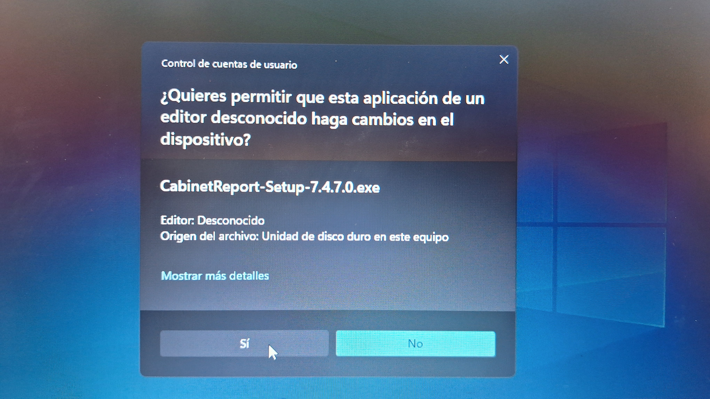

# Instalar Actualizaciones

Una actualización permite incorporar una versión de Cabinet Report, pero **descargar un instalador, ejecutar el proceso y comprobar la versión instalada son tres hechos diferentes**. Este tutorial conserva las pantallas históricas del actualizador y añade controles para reanudar una producción con prudencia.

En el recorrido ilustrado, Cabinet Report muestra un aviso de actualización después del inicio de sesión. **No se ha verificado en Windows** en esta auditoría cuándo aparece en todas las instalaciones, si la búsqueda es automática en cada sesión ni qué ocurre cuando la conexión falla. Las imágenes explican un flujo documentado; no garantizan que tu versión muestre exactamente los mismos mensajes.

## Elige la vía adecuada

| Situación | Recorrido recomendado | Precaución |
| --- | --- | --- |
| Aparece el aviso dentro de Cabinet Report | Sigue los [pasos del actualizador integrado](#1-iniciar-sesión) después de respaldar el trabajo. | No autorices acciones que no correspondan al aviso iniciado. |
| No aparece el aviso o deseas conocer las publicaciones | Consulta el [portal oficial y su historial de versiones](#consultar-y-descargar-una-versión-desde-el-portal-oficial). | Ver una versión publicada **no significa** que esté instalada en este equipo. |
| Ya descargaste un instalador manualmente | Contrasta su publicación y procedencia, y consulta soporte si dudas de la sustitución. | No ejecutes dos instalaciones simultáneas ni presupongas conservación de licencia y archivos. |

## Antes de comenzar: protege tu trabajo

Una actualización modifica la instalación del programa. **No presupongas que el actualizador crea copias de seguridad de tus proyectos** ni que conservar la licencia equivale a conservar todos los archivos de producción.

1. **Termina o guarda el trabajo en curso.** No inicies la actualización mientras estés generando, optimizando o exportando una producción.
2. **Anota la versión instalada.** Puedes consultarla en la ventana [Acerca de Cabinet Report](https://cabinet-report.gitbook.io/cabinet-report-docs/funcionalidades-de-cabinet-report/ventana-acerca-de), si está disponible en tu versión.
3. **Localiza los archivos reales de cada proyecto** y cópialos fuera de su carpeta de trabajo y, preferiblemente, en otro medio o ubicación protegida. Según tu producción, pueden existir TXT de piezas, reportes Excel, TXT auxiliares, parámetros, metadatos técnicos XML y XML de Auditoría RP. **No presupongas** que todos existen ni que copiar solo el instalador o el acceso directo del escritorio respalda tus proyectos.
4. **Comprueba el respaldo antes de modificar nada.** Registra ubicación, cliente, ambiente, número RP cuando exista y fecha. Comprueba que los archivos esperados están presentes y que puedes abrir una copia representativa. Evita sobrescribir el original con una prueba; conserva una referencia de la producción aprobada.
5. **Utiliza el aviso y el mecanismo de actualización de Cabinet Report.** Si recibes un instalador por un canal no reconocido, confirma su procedencia mediante los canales oficiales antes de ejecutarlo.


**Antes de actualizar una producción activa:** conserva el origen y los archivos aprobados por separado. La actualización no sustituye la revisión técnica, y un respaldo incompleto puede impedir reconstruir el trabajo.


## Consultar y descargar una versión desde el portal oficial

Si no aparece el aviso de actualización dentro de Cabinet Report, o necesitas **consultar qué versiones están publicadas**, puedes hacerlo desde el [portal oficial de Cabinet Report](https://danielmelendez-pma.github.io/cabinet-report-partners/). El código fuente del portal documenta el botón **Descargar última versión**, la ventana de novedades y el acceso **Versiones**; su disponibilidad real en el navegador requiere validación publicada. Este recorrido es **informativo y de descarga**: no instala automáticamente el software ni sustituye el actualizador integrado.

1. Abre el **portal oficial** y selecciona **Descargar última versión** (botón con el icono de Windows). La ventana consulta las publicaciones estables de GitHub cuando la abres; no muestra una versión fija escrita en la página.
2. Comprueba la **versión indicada**, la fecha de la versión cuando esté publicada, la fecha de publicación en GitHub y las novedades. Si existe imagen oficial, puedes ampliarla para leer sus detalles. La fecha de versión y la fecha de publicación pueden ser diferentes.
3. Si necesitas el archivo, pulsa **Descargar instalador**. Antes de abrirlo, contrasta la [publicación de GitHub Releases](https://github.com/danielmelendez-pma/CabinetReport-Updates/releases), su etiqueta, el activo adjunto y el dominio oficial del enlace. El portal exige una etiqueta con formato `vX.X.X.X` y un activo `CabinetReport-Setup-X.X.X.X.exe` asociado a esa etiqueta. **El nombre y la extensión no son prueba de seguridad**: comprueba el origen y cualquier firma o información del editor disponible; ante discrepancias, no ejecutes el archivo.
4. Si necesitas consultar una publicación anterior, utiliza la opción **Versiones** del menú superior. El historial presenta hasta diez versiones estables recientes, cada una con sus propios detalles y enlace de instalador. No selecciones una versión anterior para sustituir la instalada sin confirmar su compatibilidad y necesidad con soporte.
5. **Antes de ejecutar cualquier instalador**, completa las comprobaciones y el respaldo de la sección anterior. Si el programa ya ofrece una actualización interna, sigue primero el procedimiento indicado en esta lección; la ejecución manual de un instalador puede requerir indicaciones adicionales para tu instalación y licencia.


**No fuerces instalaciones ni desactives las protecciones de Windows.** Si GitHub no responde, el portal no permite verificar la versión o el archivo no coincide con la publicación seleccionada, no descargues una copia desde sitios alternativos. Utiliza los [canales oficiales de soporte](https://cabinet-report.gitbook.io/cabinet-report-docs/politicas-de-soporte).


### Publicada, descargada e instalada: no son equivalentes

| Estado | Qué demuestra | Qué no demuestra |
| --- | --- | --- |
| **Versión publicada** en el portal/GitHub | Existe una publicación identificable en el catálogo consultado. | Que el equipo ya esté actualizado. |
| **Instalador descargado** | Existe un archivo obtenido para una publicación. | Que se haya ejecutado, que sea auténtico solo por el nombre o que haya terminado la instalación. |
| **Instalación iniciada** | Se intentó aplicar una versión. | Que se haya completado sin errores. |
| **Versión instalada comprobada** | La aplicación abierta indica su número de versión en **Acerca de**. | Que todos los proyectos, licencias y procesos de producción estén validados. |

### Lista de comprobación antes de continuar

| Comprobación | Qué confirmar |
| --- | --- |
| **Versión instalada** | Registrar la versión visible en **Acerca de Cabinet Report**. |
| **Versión ofrecida** | Identificar su publicación estable en el portal y su instalador específico en GitHub. |
| **Procedencia** | Verificar el repositorio oficial y la correspondencia entre etiqueta y ejecutable; no confiar únicamente en el nombre. |
| **Respaldo** | Conservar y comprobar copias de los proyectos y archivos de producción afectados. |
| **Método de actualización** | Distinguir el actualizador integrado de una descarga manual y solicitar orientación antes de reemplazar una instalación en uso. |

---

## Actualizador integrado: secuencia ilustrada

Las **siete capturas siguientes son recursos históricos** conservados sin sustituir sus archivos. Los números de versión, botones y pantallas pueden diferir de los de tu instalación. Los pies describen lo visible; ninguna captura certifica el resultado de una prueba actual en Windows.

## 1. Iniciar sesión

En el procedimiento ilustrado se accede a Cabinet Report mediante la ventana de inicio de sesión. Utiliza únicamente tus propias credenciales autorizadas y no las compartas en capturas de soporte.

<figure><figcaption>
Acceso a la aplicación antes de consultar el aviso; la captura pertenece a una interfaz histórica.
</figcaption></figure>

En la secuencia capturada aparece un aviso que compara una versión actual con otra ofrecida. **No confundas esos números históricos con la última publicación disponible hoy**; confirma la versión de tu propia instalación antes de decidir.

<figure><figcaption>
Aviso de actualización mostrado tras el acceso en el flujo ilustrado; su aparición no ha sido probada en todas las versiones.
</figcaption></figure>

## 2. Iniciar la actualización

Si reconoces la actualización mostrada, identificaste la versión ofrecida y verificaste tus copias, selecciona **Actualizar**. Si estás trabajando o necesitas investigar su origen, usa **Más Tarde** cuando esa opción aparezca; no está documentado que posponer conserve indefinidamente el aviso.

<figure><figcaption>
El botón Actualizar inicia el recorrido mostrado; la imagen no prueba que el proceso termine correctamente.
</figcaption></figure>

## 3. Esperar la preparación de la actualización

Después de iniciar el proceso puede mostrarse una pantalla de espera. Mantén una conexión estable, evita abrir varios instaladores simultáneamente y atiende cualquier mensaje de error. **La captura muestra “Iniciando Cabinet Report” y un indicador de progreso; por sí sola no acredita ni el porcentaje de descarga ni que el instalador ya esté disponible.**

<figure><figcaption>
Estado de inicio o preparación mostrado en el flujo histórico; no constituye evidencia de descarga completada.
</figcaption></figure>

## 4. Autorizar la instalación

En el recorrido original se incluye una captura sobre **autorización de Windows**. Según la configuración del equipo, Windows puede pedir confirmación o credenciales administrativas. **No concedas permisos solo porque la ventana parezca habitual:** comprueba que la solicitud corresponde a la acción iniciada, revisa el editor o publicador cuando se muestre y consulta con quien administra el equipo si algo no coincide.

<figure><figcaption>
Referencia histórica al permiso de instalación; la apariencia exacta y los datos del aviso deben comprobarse en el propio equipo.
</figcaption></figure>

Si rechazas un permiso necesario, el proceso puede quedar sin completar. No desactives SmartScreen, el antivirus ni otras protecciones para forzar la ejecución; conserva una captura **sin información confidencial** y consulta soporte.

## 5. Conservar la licencia instalada

En el instalador histórico se muestra una pregunta sobre una instalación anterior. Para el **flujo de actualización representado**, la indicación visual es responder **Sí** a **mantener la licencia actual**, en lugar de elegir la opción que propone eliminarla para configurar otra. **Esta pantalla no demuestra que todos los instaladores futuros conserven la licencia sin incidencias.** Si la pregunta es diferente o inesperada, detente y consulta soporte antes de cambiar o introducir códigos.

<figure><figcaption>
El cuadro indica que Sí mantiene la licencia y No permite eliminarla y configurar una nueva; no acredita el resultado en otras versiones.
</figcaption></figure>

## 6. Finalizar el proceso

Continúa con las instrucciones que presente el instalador y espera a que termine. En el procedimiento histórico se indica que Cabinet Report se cierra y posteriormente se vuelve a abrir desde el acceso directo del escritorio; **no se ha validado aquí que el cierre o el reinicio ocurran de forma automática en todas las versiones**. Si se solicita reiniciar Windows, guarda primero tu trabajo y sigue las indicaciones autorizadas del equipo.

<figure><figcaption>
Acceso directo ilustrado para volver a abrir Cabinet Report; su presencia no acredita por sí sola una actualización correcta.
</figcaption></figure>

Volver a abrir la aplicación **no equivale a verificar la instalación**: realiza los controles siguientes antes de reanudar una producción.

## Después de actualizar: comprueba el resultado

1. **Abre Cabinet Report e inicia sesión** con el usuario habitual. Comprueba que sigues accediendo al cliente correcto; si aparece una solicitud inesperada de licencia, no sustituyas datos sin verificarla.
2. **Consulta la versión** desde la ventana [Acerca de](https://cabinet-report.gitbook.io/cabinet-report-docs/funcionalidades-de-cabinet-report/ventana-acerca-de) y compárala con la actualización que se indicó. Anota el resultado; no basta con que el programa abra.
3. **Localiza uno de tus proyectos** y comprueba su identificación y los archivos disponibles, sin sobrescribir el respaldo. Si necesitas volver a cargar un TXT, sigue el procedimiento de [Cargar TXT](reporte-de-produccion/cargar-txt.md) y valida la información después.
4. **Revisa la continuidad de los archivos** que necesitas: TXT de producción, reportes Excel, parámetros, complementarios y, cuando corresponda, XML de metadatos y de Auditoría RP. La guía [Archivos de Reportes Generados](reporte-de-produccion/archivos-de-reportes-generados.md) distingue sus propósitos; no todos se generan en cada trabajo. Si existe una revisión IA, contrasta también el estado de sus decisiones siguiendo [Auditoría RP y persistencia](https://cabinet-report.gitbook.io/cabinet-report-docs/funcionalidades-de-cabinet-report/auditoria-rp-persistencia).
5. **Antes de fabricar o entregar documentos**, contrasta piezas, cantidades, medidas, materiales, vetas y cantos con la producción aprobada. Ejecutar la actualización no acredita la validez técnica de reportes previos ni nuevos.


**Instalación y contenido son comprobaciones distintas.** Que el programa permita iniciar sesión no demuestra por sí solo que una actualización finalizó correctamente o que todos los archivos de un proyecto siguen disponibles.


## Ejercicio ficticio: separar descarga, instalación y verificación

Imagina un proyecto **DEMO-CLIENTE / COCINA-PRUEBA** (datos inventados, sin producción real). En el portal aparece una versión publicada diferente de la que indica **Acerca de** en tu equipo de ensayo. Se descarga un instalador, pero Windows solicita autorización y decides no concederla hasta confirmar el origen.

1. **Identifica qué sabes:** anota la versión publicada y la que realmente muestra la aplicación abierta. ¿Se ha probado que exista una nueva versión instalada? **No**: solo se observó una publicación y una descarga.
2. **Protege los archivos:** prepara una copia independiente de un TXT ficticio, un Excel de muestra y, si existen en el caso, XML técnicos o de auditoría. Comprueba las rutas sin sobrescribir los originales.
3. **Decide el siguiente paso:** contrasta la publicación y el activo oficial en GitHub; si el permiso no es reconocible, detén el ensayo y solicita orientación. No inventes una firma digital ni supongas que el nombre del archivo prueba seguridad.
4. **Define el criterio de éxito:** después de completar una instalación autorizada en un equipo de pruebas, inicia sesión, compara la versión en **Acerca de**, abre la producción ficticia y revisa que sus archivos y datos coincidan con el respaldo. Documenta **CONFORME**, **NO CONFORME** o **NO EJECUTADO** por separado para versión, acceso, archivos y licencia.

**Resultado esperado del escenario tal como está planteado:** la instalación queda **NO EJECUTADA** mientras no se autorice; no se debe informar como actualización exitosa por el hecho de haber descargado el archivo. Este es un ejercicio manual pedagógico, **no** una prueba funcional efectuada por esta auditoría.

## Si la actualización se interrumpe o algo no coincide

| Situación | Acción prudente |
| --- | --- |
| **Descarga incompleta o aviso inesperado** | No ejecutes instaladores de origen desconocido. Anota el origen y el mensaje, comprueba la conexión, la publicación oficial y consulta soporte antes de repetir el proceso. |
| **Instalación cerrada o interrumpida** | No borres carpetas ni archivos de producción para intentar repararla. Comprueba si el programa abre, qué versión muestra y si hubo una solicitud de permisos o reinicio; conserva el respaldo independiente. |
| **Licencia o acceso diferente al habitual** | Comprueba el cliente y el usuario utilizados. No confundas credenciales con licencia; evita sustituir, introducir o publicar códigos ante una solicitud inesperada sin validarla con soporte. |
| **Proyecto o archivos que no aparecen** | No generes ni sobrescribas el trabajo hasta comprobar la ruta, la identificación del proyecto y la copia de respaldo. Distingue un proyecto localizado de uno efectivamente recuperado. |
| **Versión no verificable o fallo persistente** | Registra la versión visible, los pasos realizados y el aviso exacto; utiliza [Reporte de Errores o Feedback](reporte-de-errores-o-feedback.md) o los [canales de soporte](https://cabinet-report.gitbook.io/cabinet-report-docs/politicas-de-soporte). |

Al solicitar ayuda, indica **versión antes/después (si se conoce)**, fecha, método utilizado (aviso integrado o instalador manual), texto del error y paso alcanzado; adjunta solo evidencia necesaria, ocultando contraseñas, licencias completas, credenciales y datos confidenciales. Las opciones de actualización y recuperación dependen de la versión instalada y del entorno.

## Referencias y límites de esta guía

- **Documentación oficial:** [Ventana Acerca de Cabinet Report](https://cabinet-report.gitbook.io/cabinet-report-docs/funcionalidades-de-cabinet-report/ventana-acerca-de) para consultar la versión visible; [Políticas de Soporte](https://cabinet-report.gitbook.io/cabinet-report-docs/politicas-de-soporte) para comunicar incidencias; [Auditoría RP y persistencia](https://cabinet-report.gitbook.io/cabinet-report-docs/funcionalidades-de-cabinet-report/auditoria-rp-persistencia) para archivos XML y revisiones.
- **Procedencia de publicaciones:** [Portal oficial](https://danielmelendez-pma.github.io/cabinet-report-partners/) y [GitHub Releases de CabinetReport-Updates](https://github.com/danielmelendez-pma/CabinetReport-Updates/releases). Se ha contrastado el **código fuente** del portal y su consulta de versiones estables; no se ha probado su respuesta de red o descarga real.
- **Documentación Técnica pública disponible:** el índice consultado se centra en **Costos**. No se ha localizado en él una especificación del actualizador que permita acreditar detección automática, instalación silenciosa, preservación universal de licencias o conservación de todos los proyectos.
- **Pendiente de validación funcional:** flujo real en Windows, comprobación de origen e integridad del binario, avisos de permisos, cierre/reinicio, versión efectivamente instalada y conservación de licencia/proyectos. La revisión de Markdown o de capturas **no sustituye** estos ensayos.

---

[← Acceso y licencias](<README (1).md>) · [Reporte de Errores o Feedback](reporte-de-errores-o-feedback.md) · [🏠 Portal principal](https://danielmelendez-pma.github.io/cabinet-report-partners/)

